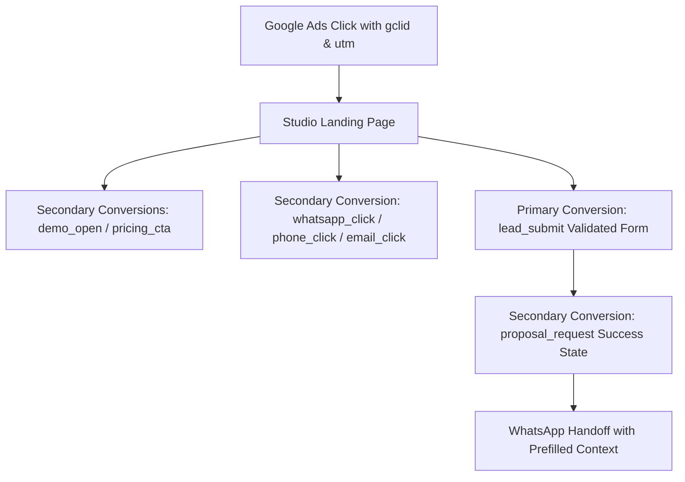

# Google Ads Campaign Setup & Conversion Architecture

> [!NOTE]
> **Historical Record**: This document is an archived milestone report reflecting project progress and specifications at the time of authoring. The active, consolidated source of truth for Vardan Pal Studio is maintained in [`docs/VARDAN_PAL_STUDIO_MASTER.md`](./docs/VARDAN_PAL_STUDIO_MASTER.md).
**Vardan Pal Studio — Independent Web Design & Development Studio**  
*New Delhi, India · Serving Businesses Nationwide*  
*Last Updated: October 2026*

---

## 1. Executive Summary & Strategy

This document specifies the initial Google Ads search campaign architecture, targeting guidelines, negative keyword sets, responsive search ad (RSA) copy, and conversion hierarchy for **Vardan Pal Studio**.

### Strategic Principles
1. **Search Campaigns Only Initially:** We do **not** run Performance Max (PMax) or Display campaigns at launch. Broad display and automated PMax campaigns waste budget on low-intent mobile gaming traffic and scraper impressions. High-intent Google Search captures clients actively looking for professional web design services.
2. **Controlled Budgeting:** Start conservatively with **₹500 to ₹800 per day** only if financially comfortable. Maintain this test for **2 to 4 weeks** without increasing budget until qualified leads and the Search Terms report have been audited.
3. **No Unsupported Guarantees:** Ad copy adheres strictly to ethical, professional, and verifiable claims. No promises of guaranteed revenue, rankings, or overnight sales.
4. **Transparent Pricing Alignment:** Messaging matches the studio's published pricing structure:
   - **Launch:** from ₹9,900
   - **Business:** from ₹19,900
   - **Signature:** from ₹34,900
   - **Custom Systems:** quoted after discovery

---

## 2. Campaign Configuration

| Setting | Recommendation | Rationale |
|---|---|---|
| **Campaign Goal** | Leads (Search Network) | Focuses bids exclusively on user searches demonstrating commercial intent. |
| **Campaign Type** | Search Network only | Disables Search Partners and Google Display Network expansion. |
| **Bidding Strategy** | Maximize Clicks (with Max CPC bid cap of ₹25–₹45) initially &rarr; Transition to Maximize Conversions once 15–20 valid `lead_submit` events fire. | Prevents Google from overbidding on erratic initial traffic before conversion history stabilizes. |
| **Daily Budget** | ₹500 – ₹800 / day (₹15,000 – ₹24,000 / month) | Provides 15–30 qualified clicks per day to establish benchmark CPC and conversion rates. |
| **Duration** | 2 to 4 weeks controlled baseline test | Do not increase budget before reviewing qualified leads and search queries. |

### Location Targeting
- **Primary Market:** New Delhi / NCR (Radius: 35 km around South Delhi / Central Delhi / Gurugram / Noida).
- **Secondary Market:** Pan-India (All Indian states & Union Territories), provided landing pages and sales channels are configured to serve remote consultations via WhatsApp and video meetings.
- **Physical Presence Disclosure:** The studio is physically based in New Delhi. **Do not claim a physical Bengaluru or Mumbai office.** If targeting technology hubs like Bengaluru or Hyderabad, clearly position them as a *remote service location* ("Serving Bengaluru businesses nationwide"), never as a physical branch.

---

## 3. Initial Ad Groups & Keyword Architecture

We run **6 tightly themed Ad Groups** using **Exact Match `[...]`** and **Phrase Match `"..."`** keywords exclusively. **Broad match is strictly prohibited** during initial testing to avoid search term inflation.

### Ad Group 1: Clinic Website Design
*Focus: Dentists, dermatologists, aesthetic clinics, and medical specialists.*
- `[clinic website design]`
- `"clinic website design"`
- `[dental website designer]`
- `"dental clinic website design"`
- `[doctor website development]`
- `"dermatology clinic website designer"`
- `"website design for medical clinic"`

### Ad Group 2: Salon Website Design
*Focus: Luxury hair salons, spas, bridal makeup studios, aesthetic wellness centers.*
- `[salon website design]`
- `"salon website design"`
- `[website designer for salon]`
- `"beauty salon website development"`
- `[spa website designer]`
- `"hair salon website design delhi"`

### Ad Group 3: Restaurant Website Design
*Focus: Fine dining restaurants, cafes, bakeries, cocktail lounges, and boutique bistros.*
- `[restaurant website design]`
- `"restaurant website design"`
- `[cafe website designer]`
- `"restaurant menu website development"`
- `"bar and restaurant website design"`
- `[cloud kitchen website design]`

### Ad Group 4: Small-Business Website Design
*Focus: Local service businesses, consultants, boutique firms, independent studios.*
- `[small business website design]`
- `"small business website design"`
- `[website design for small business india]`
- `"affordable business website designer"`
- `[professional website design packages]`
- `"website design under 20000"`

### Ad Group 5: Website Designer Delhi
*Focus: Local high-intent commercial searches in Delhi NCR.*
- `[website designer delhi]`
- `"website designer delhi"`
- `[web design studio south delhi]`
- `"website development company delhi"`
- `[freelance website developer delhi]`
- `"website designer in new delhi"`

### Ad Group 6: Website Designer India
*Focus: Pan-India high-intent commercial searches.*
- `[website designer india]`
- `"website designer india"`
- `[web design studio india]`
- `"freelance web developer india"`
- `[independent website designer india]`
- `"custom website development india"`

---

## 4. Universal Negative Keyword List

Apply this master negative keyword list to the entire campaign to prevent wasteful clicks:

| Category | Negative Keywords |
|---|---|
| **Employment & Careers** | `jobs`, `job`, `salary`, `internship`, `hiring`, `career`, `fresher`, `vacancy` |
| **Education & Tutorials** | `course`, `training`, `tutorial`, `learn`, `how to make a website`, `source code`, `html tutorial`, `css tutorial`, `javascript tutorial` |
| **Free / Cheap Seekers** | `free`, `template`, `theme`, `download`, `pdf`, `torrent`, `nulled`, `crack`, `canva`, `wix tutorial`, `wordpress theme`, `website builder tutorial` |
| **Accounts / Portals** | `login`, `signin`, `portal`, `github`, `cpanel`, `webmail` |

### Weekly Search Terms Report Audit Protocol
1. **Cadence:** Review every **Monday morning**.
2. **Process:** Navigate to *Google Ads &rarr; Insights & reports &rarr; Search terms*.
3. **Action:** Filter by Impressions > 0 and Clicks > 0.
4. **Addition:** Identify any irrelevant intent (e.g., student inquiries, competitor support searches, platform login terms) and add them as **Negative Exact** or **Negative Phrase** keywords immediately.

---

## 5. Responsive Search Ad (RSA) Copy Specifications

All ad copy complies with Google Ads editorial guidelines and studio credibility standards.

### Strict Copy Guidelines
- **Prohibited Claims:** Do NOT use "Guaranteed leads", "Number-one rankings", "Guaranteed sales", "Best website designer", "Lowest price", "Instant results", or "Guaranteed ROI".
- **Approved Claims:** Work directly with founder developer, mobile-first performance, transparent pricing from ₹9,900, WhatsApp intake readiness, live portfolio options.

---

### Ad Group 1: Clinic Website Design

#### RSA Concept 1 (Appointment & Patient Flow Focus)
- **Headlines (up to 30 chars each):**
  1. Website Design for Clinics
  2. Appointment & WhatsApp Ready
  3. Explore Live Clinic Demos
  4. Work Directly With Developer
  5. Packages From ₹9,900
- **Descriptions (up to 90 chars each):**
  1. "Modern clinic websites with treatment pages, appointment enquiry flows and WhatsApp."
  2. "Explore live design options and request a proposal. Direct developer communication."
- **Final URL:** `https://vardanpalstudio.vercel.app/?utm_source=google&utm_medium=cpc&utm_campaign=clinic-website&package=Business#work`

#### RSA Concept 2 (Doctor & Trust Credibility Focus)
- **Headlines:**
  1. Clinic & Dental Websites
  2. Mobile-First Medical Sites
  3. Clear Scope. Direct Delivery.
  4. View Working Clinic Designs
  5. Request a Website Proposal
- **Descriptions:**
  1. "Modern clinic websites with treatment pages, appointment enquiry flows and WhatsApp integration."
  2. "Transparent packages from ₹9,900. No agency middlemen. Explore live design options."
- **Final URL:** `https://vardanpalstudio.vercel.app/?utm_source=google&utm_medium=cpc&utm_campaign=clinic-website#pricing`

---

### Ad Group 2: Salon Website Design

#### RSA Concept 1 (VIP Booking & Visual Portfolio Focus)
- **Headlines:**
  1. Website Design for Salons
  2. WhatsApp Booking & Lookbooks
  3. View Live Salon Demos
  4. Websites From ₹9,900
  5. Work Directly With Developer
- **Descriptions:**
  1. "Modern websites with clear services, enquiry flows, WhatsApp integration and mobile-first."
  2. "Explore live design options and request a proposal. Direct developer communication."
- **Final URL:** `https://vardanpalstudio.vercel.app/?utm_source=google&utm_medium=cpc&utm_campaign=salon-website&package=Business#work`

#### RSA Concept 2 (Premium Editorial Focus)
- **Headlines:**
  1. Salon & Spa Websites
  2. Mobile-First & WhatsApp Ready
  3. Explore Live Design Options
  4. Packages From ₹9,900
  5. Request a Website Proposal
- **Descriptions:**
  1. "Modern salon websites with lookbooks, service menus, and direct WhatsApp chair booking."
  2. "Transparent packages from ₹9,900. Built directly by engineer. Explore live designs."
- **Final URL:** `https://vardanpalstudio.vercel.app/?utm_source=google&utm_medium=cpc&utm_campaign=salon-website#pricing`

---

### Ad Group 3: Restaurant Website Design

#### RSA Concept 1 (Table Reservation & Menu Focus)
- **Headlines:**
  1. Restaurant Website Design
  2. Menus & Table Inquiries
  3. View Live Restaurant Demos
  4. Work Directly With Developer
  5. Websites From ₹9,900
- **Descriptions:**
  1. "Modern websites with clear services, enquiry flows, WhatsApp integration and mobile-first."
  2. "Explore live design options and request a proposal. Direct developer communication."
- **Final URL:** `https://vardanpalstudio.vercel.app/?utm_source=google&utm_medium=cpc&utm_campaign=restaurant-website&package=Business#work`

#### RSA Concept 2 (Cafe & Hospitality Focus)
- **Headlines:**
  1. Website Design for Cafes
  2. Mobile-First & WhatsApp Ready
  3. Clear Scope. Direct Developer.
  4. Explore Live Design Options
  5. Request a Website Proposal
- **Descriptions:**
  1. "Digital menus, photo lookbooks, and instant WhatsApp booking for dining establishments."
  2. "Packages starting from ₹9,900. Fast turnaround. Review live interactive concepts."
- **Final URL:** `https://vardanpalstudio.vercel.app/?utm_source=google&utm_medium=cpc&utm_campaign=restaurant-website#pricing`

---

### Ad Group 4: Small-Business Website Design

#### RSA Concept 1 (Value & Direct Engineering Focus)
- **Headlines:**
  1. Small Business Website Design
  2. Websites From ₹9,900
  3. Work Directly With Developer
  4. Mobile-First & WhatsApp Ready
  5. Clear Scope. Fast Delivery.
- **Descriptions:**
  1. "Modern websites with clear services, enquiry flows, WhatsApp integration and mobile-first."
  2. "Explore live design options and request a proposal. Direct developer communication."
- **Final URL:** `https://vardanpalstudio.vercel.app/?utm_source=google&utm_medium=cpc&utm_campaign=small-biz#pricing`

#### RSA Concept 2 (Package Transparency Focus)
- **Headlines:**
  1. Website Packages From ₹9,900
  2. Launch, Business & Custom
  3. Direct Engineer Communication
  4. View Live Design Options
  5. Request a Website Proposal
- **Descriptions:**
  1. "Transparent packages: Launch ₹9,900, Business ₹19,900, Signature ₹34,900. No surprises."
  2. "Modern websites designed and built directly by founder. Explore live options today."
- **Final URL:** `https://vardanpalstudio.vercel.app/?utm_source=google&utm_medium=cpc&utm_campaign=small-biz#pricing`

---

### Ad Group 5: Website Designer Delhi

#### RSA Concept 1 (Delhi Studio Credibility Focus)
- **Headlines:**
  1. Website Designer Delhi
  2. Web Design Studio New Delhi
  3. Work Directly With Developer
  4. Websites From ₹9,900
  5. View Live Design Options
- **Descriptions:**
  1. "Modern websites with clear services, enquiry flows, WhatsApp integration and mobile-first."
  2. "Explore live design options and request a proposal. Direct developer communication."
- **Final URL:** `https://vardanpalstudio.vercel.app/?utm_source=google&utm_medium=cpc&utm_campaign=delhi-designer#contact`

#### RSA Concept 2 (Local Business Focus)
- **Headlines:**
  1. Web Studio in New Delhi
  2. Mobile-First & WhatsApp Ready
  3. Websites From ₹9,900
  4. Clear Scope. Direct Delivery.
  5. Request a Website Proposal
- **Descriptions:**
  1. "Independent studio in New Delhi serving local businesses. Direct developer access."
  2. "Transparent fixed packages: Launch ₹9,900, Business ₹19,900. Check live demos now."
- **Final URL:** `https://vardanpalstudio.vercel.app/?utm_source=google&utm_medium=cpc&utm_campaign=delhi-designer#pricing`

---

### Ad Group 6: Website Designer India

#### RSA Concept 1 (Pan-India Service Focus)
- **Headlines:**
  1. Website Designer India
  2. Custom Websites Across India
  3. Work Directly With Developer
  4. Websites From ₹9,900
  5. View Live Design Options
- **Descriptions:**
  1. "Modern websites with clear services, enquiry flows, WhatsApp integration and mobile-first development."
  2. "Explore live design options and request a proposal. Serving clients nationwide."
- **Final URL:** `https://vardanpalstudio.vercel.app/?utm_source=google&utm_medium=cpc&utm_campaign=india-designer#pricing`

#### RSA Concept 2 (Engineering Craft Focus)
- **Headlines:**
  1. Web Design Studio India
  2. Mobile-First & WhatsApp Ready
  3. Websites From ₹9,900
  4. Clear Scope. Direct Contact.
  5. Request a Website Proposal
- **Descriptions:**
  1. "High-performance business websites built by NIT engineer. Clear scope and delivery."
  2. "Packages from ₹9,900 to custom systems. Explore working interactive prototypes."
- **Final URL:** `https://vardanpalstudio.vercel.app/?utm_source=google&utm_medium=cpc&utm_campaign=india-designer#contact`

---

## 6. Landing Page Alignment Note

*Important Architectural Rule:*  
Every ad must link to a relevant landing section or page. During initial launch, ads route directly to targeted anchors on `index.html` (e.g. `#work` for demos, `#pricing` for packages, `#contact` for enquiries) with full UTM preservation.  
**Before scaling ad budget beyond ₹800/day**, dedicated industry-specific landing pages (e.g., `/clinic-website-design.html`) should be generated to maximize Quality Score and ad relevance.

---

## 7. Conversion Tracking Hierarchy & Lead Pipeline

### Conversion Hierarchy



#### Primary Conversion (Bidding Metric in Google Ads)
- **`lead_submit`**: Fires **only** after client-side form validation succeeds (valid name, valid email, phone number, and checked consent box) and before WhatsApp redirection.
- **Why it is Primary:** This represents a qualified contact who has formally requested a website scope proposal with verifiable contact details.

#### Secondary Conversions (Observation & Diagnostics Only)
These actions are tracked for journey analytics but **not** used as primary automated bidding targets:
1. **`whatsapp_click`**: User clicked a floating or embedded WhatsApp button.
2. **`phone_click`**: User initiated a phone call.
3. **`email_click`**: User clicked an email link.
4. **`demo_open`**: Visitor navigated to a demo website (opens directly in same tab with native scroll restoration).
5. **`pricing_cta`**: User selected a package button.
6. **`proposal_request`**: User reached the confirmation view.

> **Principle:** A click or an interaction is **not** the same as a qualified lead. Do not optimize bidding algorithms on top-of-funnel clicks, as this leads to bidding on bot traffic and accidental taps.

---

## 8. Lead Pipeline Management & CRM Schema

All enquiries should be logged immediately into a simple private spreadsheet or CRM (Google Sheets, Notion, or Airtable). **Never store client PII in public analytics systems.**

### Lead Pipeline Stages
```
New ──> Contacted ──> Qualified ──> Proposal Sent ──> [ Won | Lost ]
```

1. **New:** Enquiry received via form / API / WhatsApp.
2. **Contacted:** Founder responded via WhatsApp or phone call within 2–4 hours.
3. **Qualified:** Confirmed project requirements, budget fit (₹9,900+), and timeline feasibility.
4. **Proposal Sent:** Tailored scope, milestone breakdown, and pricing document delivered.
5. **Won:** Commencement deposit received, project initiated.
6. **Lost:** Lead disqualified, unresponsive, or budget mismatch (document reason).

### Recommended CRM Spreadsheet Schema

| Column Name | Type | Description | Example |
|---|---|---|---|
| **Date** | Date | Submission timestamp | `2026-10-07` |
| **Name** | Text | Client full name | `Dr. Rohit Mehta` |
| **Business** | Text | Practice or company name | `Mehta Dental Clinic` |
| **City** | Text | Location | `South Delhi` |
| **Industry** | Dropdown | Industry category | `Clinic / Healthcare` |
| **Source** | Text | `utm_source` | `google` |
| **Campaign** | Text | `utm_campaign` | `clinic-search` |
| **Keyword / Term** | Text | `utm_term` | `dental clinic website design` |
| **Package Interest** | Dropdown | Selected tier | `Business (₹19,900)` |
| **Status** | Dropdown | Pipeline stage | `Qualified` |
| **Follow-up Date** | Date | Next scheduled touchpoint | `2026-10-09` |
| **Quoted Amount** | Currency | Proposal value in INR | `₹24,500` |
| **Won / Lost Reason**| Text | Outcome analysis | `Approved: Wanted custom patient intake` |
| **Notes** | Text | Private client requirements | `Needs clinic photoshoot referral` |
